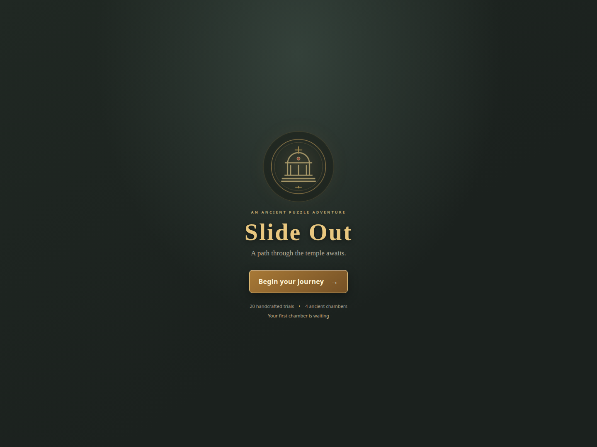
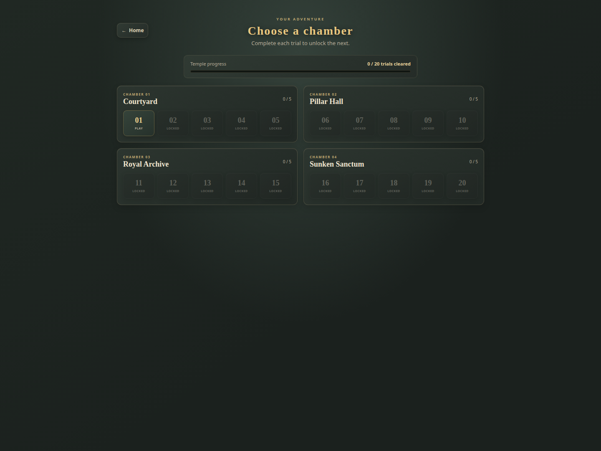
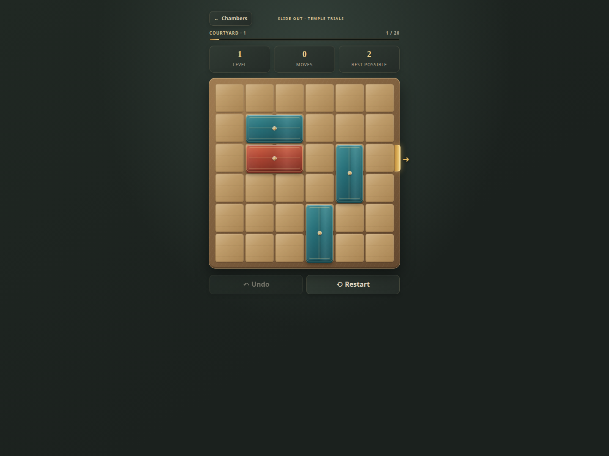

# Slide Out — Temple Trials

An ancient-temple sliding-block puzzle game. Move the carved stones out of the way and guide the crimson relic to the golden exit.



**20 handcrafted puzzles. Four temple chambers. One path to freedom.**

## Screenshots

| Choose your next chamber | Solve the puzzle |
|:---:|:---:|
|  |  |

## How to play

1. Select **Begin your journey** on the title screen.
2. Choose the available level. New levels unlock one at a time as you complete puzzles.
3. Drag the colored stones along their length to clear the path.
4. Slide the red relic through the golden gate.
5. Earn up to three stars by completing the puzzle in as few moves as possible.

Your move count, the puzzle's best possible move count, and campaign progress are shown while you play. Use **Undo** to take back a move or **Restart** to reset the current puzzle.

## Play the browser game

The browser version uses plain HTML, CSS, and JavaScript. No build step or package installation is needed.

**Option 1: Open the game directly**

Open [`web/index.html`](web/index.html) in a browser.

**Option 2: Run a local web server**

From the project root, run:

```bash
python -m http.server 8000 --directory web
```

Then open [http://localhost:8000](http://localhost:8000).

## Play the Pygame version

Install Python 3 and Pygame, then run:

```bash
python -m pip install pygame
python python/slide_out.py
```

### Keyboard and mouse controls

| Action | Browser | Pygame |
|:---|:---|:---|
| Move a stone | Drag with mouse or touch | Drag with mouse |
| Undo | Select **Undo** | — |
| Restart puzzle | Select **Restart** | Press `R` |
| Return to the level map | Select **Chambers** | Press `Esc` |
| Start from the title screen | Select **Begin your journey** | Press `Enter` or `Space` |
| Continue after solving a puzzle | Select **Next level** | Press `Space` |

## Campaign and saved progress

The campaign contains **20 levels** across four chapters:

1. Courtyard
2. Pillar Hall
3. Royal Archive
4. Sunken Sanctum

Only Level 1 is unlocked at the start. Clearing a level unlocks the next one. Progress is saved automatically:

- **Browser:** in local browser storage.
- **Pygame:** in `~/.slide_out_progress.json`.

## Project structure

```text
.
├── docs/
│   └── screenshots/        # README screenshots
├── python/
│   └── slide_out.py        # Pygame version
├── web/
│   ├── index.html          # Browser game entry point
│   ├── script.js           # Levels, controls, and progression
│   └── style.css           # Temple-themed game styling
└── README.md
```
